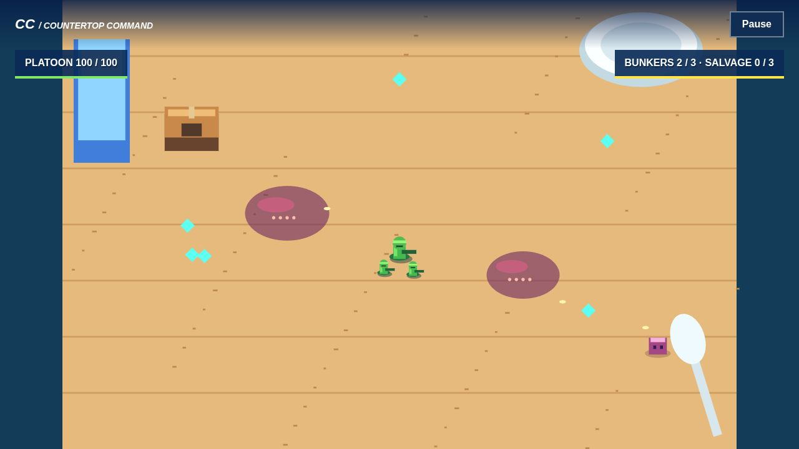

# Countertop Command

A tiny green platoon takes on an oversized kitchen. Move across the counter while your squad automatically fires at the nearest toy or cardboard bunker. Break all three bunkers to summon the wind-up robot, then defeat it to win. Lose when platoon health reaches zero. Collect cyan salvage; every three pieces pause combat for a choice of healing, damage or firing-speed upgrades. Soda puddles slow movement.



Play: https://ghavn.github.io/countertop-command/

Inspired by the community idea [Plastic Platoon](https://gamehavn.com/ideas/plastic-platoon-household-toy-soldier-roguelite) on [GameHavn](https://gamehavn.com). GameHavn publication links will be added after verification.

## Controls and status

- WASD or arrow keys: move. Shooting automatically targets the closest enemy.
- Touch: drag from your initial contact point to steer; release to stop.
- P, Escape or Pause: pause/resume. Losing browser focus pauses combat.
- Upgrade cards: choose one to resume. Deploy Again starts a fresh run after victory or defeat.

The first version has one arena, three bunkers, endlessly arriving toy enemies, one pursuing boss, three upgrade choices, win/lose screens and restart. Two companion soldiers are visual squad members; health and firing are shared. No multiplayer, sound, permanent progression, procedural rooms or independent squad AI yet.

## Run and build

Tested with Node.js 22.22.1 and npm 9.2.0. Use Node 22 or later supported by Vite. Dependency versions are pinned by package-lock.json.

```sh
npm ci
npm run dev
npm run build
npm run preview
```

Development defaults to port 5173, production preview to 4173. Both bind all interfaces for device testing. `build` runs TypeScript checking, then creates `dist/`. It passes `--base=./` so scripts and styles resolve beneath the repository path on GitHub Pages and also when embedded. No environment variables, secrets or server are required.

## Project map

- `index.html`: English mission briefing, canvas, HUD, pause button, upgrade overlay and touch instructions.
- `src/main.ts`: Canvas renderer, world coordinates, keyboard/pointer input, state transitions, movement, collision, spawning, automatic targeting, projectiles, salvage, upgrades and restart.
- `src/style.css`: blue/yellow mission interface, responsive text sizes, touch hint and upgrade-card layouts.
- `public/gameplay.jpg`: captured gameplay, copied into the production build.
- `.github/workflows/pages.yml`: build and deployment from `main` using GitHub Pages artifacts.
- `tsconfig.json`, `package.json`, `package-lock.json`: compiler settings, commands and locked dependencies.

## How the game works and how to rebuild it

1. Define a 1200 by 800 logical world. Resize the backing canvas for device pixel ratio and fit the entire world inside the viewport with letterboxing. Drawing uses the same offset and scale everywhere.
2. Create three bunkers, reset health and counters, and enter `play` when Deploy is clicked. `menu`, `pause`, `upgrade` and `end` stop simulation while keeping rendering active.
3. Track keyboard keys in a set. Normalize diagonal movement. Pointer input creates a relative virtual stick; releasing cancels movement. Clamp the player to the counter. Puddles multiply speed by 0.45.
4. Spawn toy enemies from the left or right edge. Move them toward the player using normalized direction vectors. Contact damage uses per-enemy cooldowns. Bunkers remain stationary and cause contact damage too.
5. On each firing cooldown, find the closest living unit and launch a projectile. Integrate position with delta time and check circular collision against each target. Remove expired shots and defeated units. Clamp frame delta to avoid simulation jumps after a suspended tab.
6. Defeated units drop salvage. Collect within 65 world units. Each three pickups opens the upgrade overlay and halts combat. Upgrade handlers apply their effects only to the current run.
7. Once all bunkers fall, create a tougher wind-up robot. Defeating it wins; zero player health loses. The end screen records defeated toys, elapsed seconds and upgrades. Restart rebuilds all transient state.
8. Draw household objects, plastic soldiers, enemies and effects directly with Canvas shapes. The blue briefing layer, yellow deployment button, green health underline and yellow objective underline are intentional game-specific UI elements. All art is code-generated at runtime; no downloaded or generated image assets are needed.

To extend this version, extract input, simulation and rendering into separate modules first. Add a new enemy kind with movement, collision radius and drawing behavior; add upgrades through the existing choice array. Add seeded level layouts and explicit obstacle collision before introducing more household arenas. The current counter props are decorative; puddles and units are the gameplay obstacles.

## GitHub Pages and embedding

In repository Settings > Pages, choose GitHub Actions. Push to `main` to trigger the workflow. The job installs the lockfile with `npm ci`, checks/builds, uploads `dist/`, and deploys using the Pages environment. The workflow needs contents read, pages write and id-token write. No paid hosting or backend is used.

The public URL is `https://ghavn.github.io/countertop-command/`. Source uploads alone do not deploy the game: wait for the deployment job to finish and verify that URL in a signed-out browser. Relative asset paths support `/countertop-command/`. No service worker or login is involved. Keyboard focus must be inside the game iframe. Touch handling is restricted to the canvas.

GameHavn iframe configuration: `sandbox="allow-scripts allow-same-origin allow-pointer-lock"` and `allow="fullscreen; gamepad"`. The game does not require pointer lock or gamepad support. Fullscreen is supplied by the host player.

## Manual verification

1. Open the production URL without authentication. Check the title and briefing at desktop and mobile sizes.
2. Deploy and move in all four directions. Check diagonal speed, automatic fire, bunker health bars, destruction and salvage drops.
3. Walk through a soda puddle and confirm the STICKY indicator and reduced speed.
4. Collect three salvage pieces and choose each upgrade in separate runs.
5. Destroy all bunkers, defeat the robot, and restart. Also allow the platoon to lose and restart.
6. Pause with the button, P and Escape; resume. Move focus away and verify automatic pause.
7. On a touch device, drag/release on the canvas. Check portrait and landscape text, clipping and touch hint.
8. Repeat controls and restart inside the exact GameHavn sandbox. Test its fullscreen and external-play actions.

## Limitations and roadmap

The graphics are stylized flat Canvas art rather than a full pixel-art asset set. The single fixed arena is letterboxed on tall screens. There is no audio, persistent save, deterministic seed, settings screen or accessibility mode for the canvas. Bunkers have contact damage rather than ranged attacks; the robot pursues rather than using a multi-phase attack pattern. Difficulty and upgrade balance need further playtesting.

Next steps: larger mobile battlefield framing, audio and hit feedback, independent squad roles, obstacle collision, robot attack telegraphs, seeded kitchen layouts, then attic and sandbox arenas. Add targeted simulation tests when splitting the game loop into modules.

## Credits and license

Game concept: Wick & Ash Games via the original GameHavn idea linked above. Implementation and original procedural artwork: Jochen Labs. The interface uses energetic colors and bold mission typography inspired by the user's requested direction; it contains no Fortnite assets, logos or copied artwork. Fonts use the device's Arial/Helvetica/sans-serif stack. Vite and TypeScript are third-party development dependencies; their licenses remain with their authors. No project license has been selected; this repository does not grant a separate open-source license.
